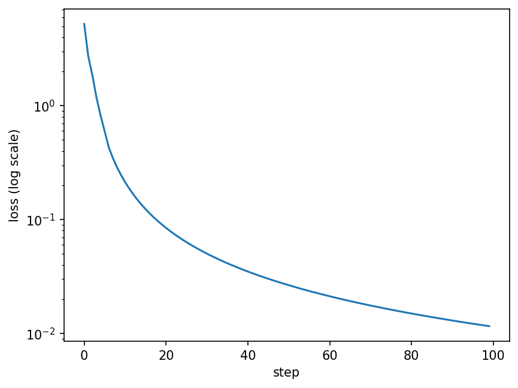
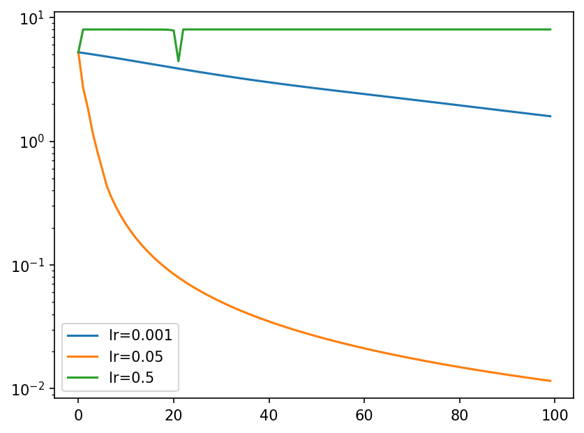

# Gradient_Engine from Scratch

A tiny autograd engine in plain Python, with a small neural-network library on top. Every number is a `Value` that remembers how it was computed, so calling `.backward()` on the final result fills in the gradient of everything that fed into it. It's the same idea as PyTorch's autograd, just for single numbers instead of tensors.

## What's in it

- A `Value` class supporting `+`, `-`, `*`, `/`, powers, `exp`, `tanh` and `relu`, with plain numbers on either side (`2 * a` works).
- `backward()`: it sorts the graph topologically, then applies the chain rule in reverse.
- `Neuron`, `Layer` and `MLP` classes built on top.
- A training loop with plain gradient descent.

Each operation stores a small `_backward` function that knows its own local derivative. `backward()` just calls them in the right order. Gradients are added with `+=`, because a value used in two places gets gradient from both.

## Does it actually work?

I checked it three ways.

**By hand**, on a small expression: a = 2, b = -3, c = 10, f = -2, with L = (a·b + c)·f = -8.

| | a | b | c | f |
|---|---|---|---|---|
| gradient | 6 | -4 | -2 | 4 |

**Numerically**, with central differences, (f(x+h) - f(x-h)) / 2h. It gives the same numbers.

**Against PyTorch**, on a 12-operation expression that uses every operator, reuses values and passes ReLU on both sides of zero. Both give g = 24.7041, a.grad = 138.8338 and b.grad = 645.5773, matching to 6 significant digits.

There are also a few small tests, each aimed at one specific bug:

- `x + x` must give `x.grad = 2`. Writing `=` instead of `+=` gives 1.
- A middle node used twice must give a.grad = 144 and b.grad = 132. Without the `visited` set in `backward()` you get 198 and 168.

## Training

An `MLP(3, [4, 4, 1])` (41 parameters) learning four examples with squared-error loss, learning rate 0.05, 100 steps:

- The loss goes from 5.23 to 0.012.
- The predictions end at [0.946, -0.965, -0.93, 0.951] for targets [1, -1, -1, 1].

## Two experiments

**Learning rate.** I tried three values from the same starting weights:

- **0.001:** too slow; the loss is still 1.59 after 100 steps.
- **0.05:** works.
- **0.5:** gets stuck at a loss of exactly 8. The first big step pushes every tanh into its flat region, where its slope (1 - t²) is almost 0, so almost no gradient gets through. Every prediction becomes 1.0, the errors against [1, -1, -1, 1] are 0, 2, 2, 0, and the loss is 0 + 4 + 4 + 0 = 8.

**Forgetting to reset the gradients.** On the toy problem this actually looked *better*: the loss was 0.0001 by step 9. On the simplest possible problem, minimising w² from w = 3, it shows why it's a bug. With resets, w moves smoothly toward 0 (2.4, 1.92, 1.54, ...). Without them, w shoots past 0 and reaches -3.01 by step 6, because each update uses the sum of every gradient so far.

## Bugs I hit

- My first constructor stored the wrong thing as the node's children (`set((data, inputs))`), so the graph wasn't really a graph.
- `__truediv__` used a variable called `b` instead of `other`. It still worked whenever a global `b` happened to exist, so most tests passed. The PyTorch comparison caught it: b.grad came out as 633.33 instead of 645.58. Lesson: restart and run all before trusting a notebook.
- Calling `backward()` twice on the same graph silently adds the gradients up: you get 24 instead of 6.

## What I learned

- Backprop is just the chain rule applied in reverse order. Each node only needs to know its own local derivative.
- Addition passes the gradient through unchanged, and multiplication swaps the inputs.
- Tiny tests with exact answers catch the bugs that plausible-looking numbers hide.
- This is exactly what `loss.backward()` does in PyTorch, which made PyTorch a lot less mysterious.

## Running it

Open the notebook in Colab and run all. It's plain Python, so it needs no GPU and finishes in well under a minute. The PyTorch comparison uses `torch`, which Colab already has.

## Credits

Based on Andrej Karpathy's [micrograd](https://github.com/karpathy/micrograd) and his lecture [The spelled-out intro to neural networks and backpropagation](https://karpathy.ai/zero-to-hero.html).
